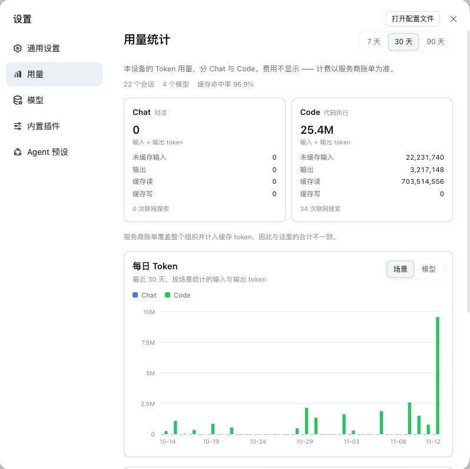
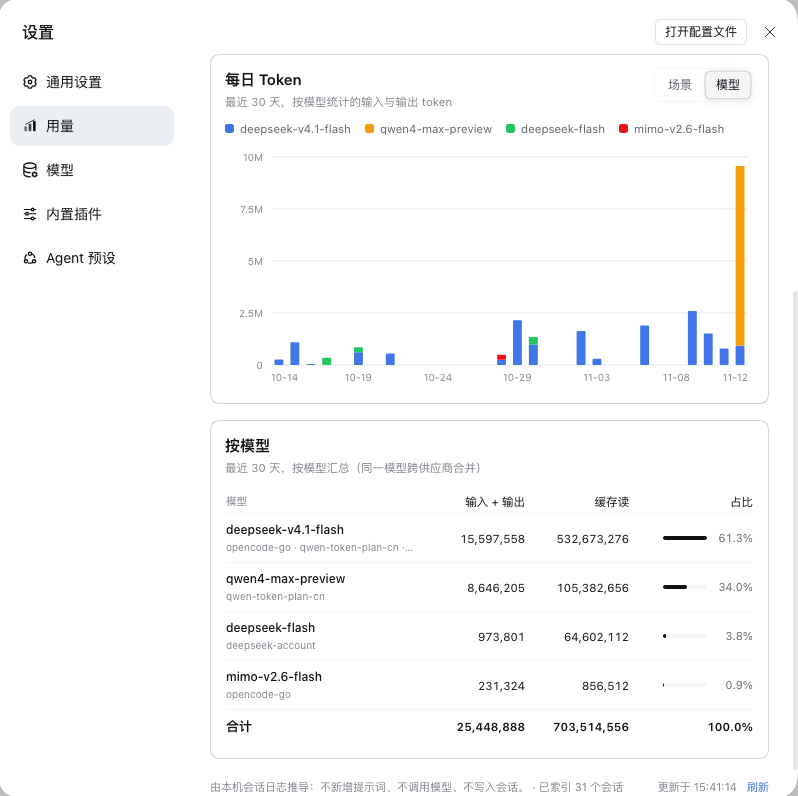
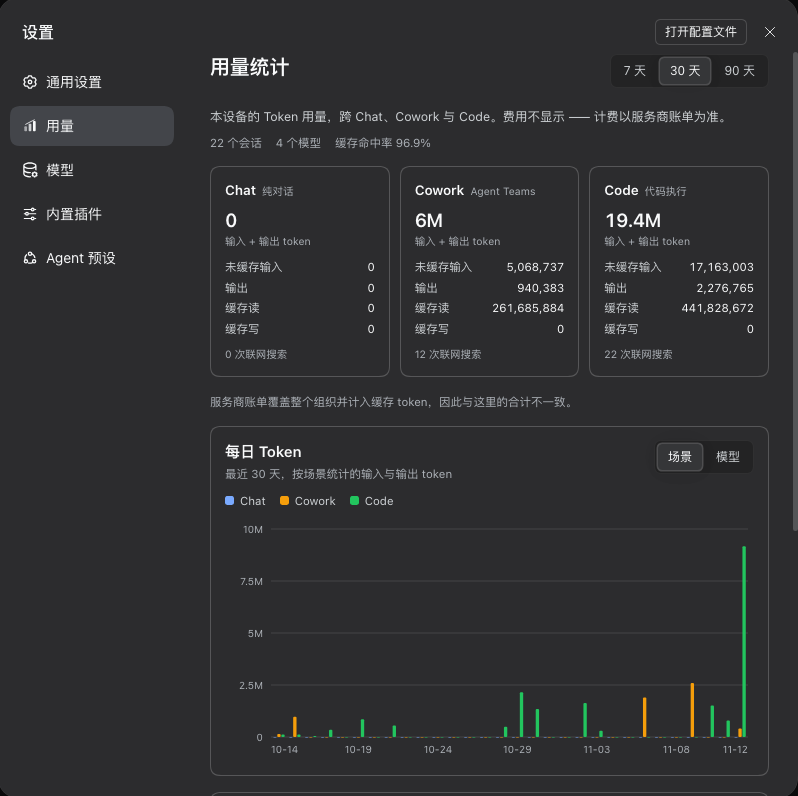

# dsh-usage-stats · Usage stats

> Local token usage for this machine, on the Harness settings' **Usage** page · A DeepSeek Harness plugin

**English:** See where this device's tokens went: Chat and Code cards, tokens per day, and a per-model breakdown, all folded from the local session logs the Harness already writes.

**中文：** 看清本机的 token 花在了哪里：Chat / Code 两张场景卡片、每日 Token 柱状图、按模型明细，全部推导自 Harness 已经写下的本地会话日志。

Everything on the page is derived from session logs DeepSeek Harness records anyway. The plugin adds no prompt, no tool and no model call, writes nothing to your sessions, and never contacts an external service — the page talks to one local route on the Harness host. The same logs always fold into the same numbers.

[中文说明 →](README.zh.md)

## Screenshots







## What you get

Open the Harness settings panel and choose **Usage** (「用量」) in the left navigation. The page is one scroll, top to bottom:

1. **Title and range** — a 7 / 30 / 90 days switch, 30 days by default; changing it refetches immediately.
2. **Two scene cards** — Chat and Code. Each has input + output as its headline number, four detail rows — Uncached input, Output, Cache read, Cache write — and a count of the web searches its sessions made.
3. **Billing note** — provider bills cover the whole organization and charge for cached tokens, so they will not match these totals.
4. **Tokens per day** — the bar chart, with a Scene / Model grouping switch and a per-day tooltip.
5. **By model** — the per-model table with a share bar on every row.
6. **Footer** — how the numbers are derived, the last update time and a Refresh button.

A few details:

- **Headline vs. detail.** A card's big number is input + output; cache is excluded, as on the reference page. Cache reads and writes are listed separately because providers bill them differently. Detail rows show exact counts with thousands separators; headlines and the chart use compact K/M/B values.
- **Summary chips.** Under the subtitle: sessions with activity in the range, models in the range, and the cache hit rate — cache reads ÷ (input + cache reads + cache writes).
- **Chart.** In Scene mode each day has two grouped bars — Chat, Code — in their scene colours. In Model mode each day is one stacked bar for the six largest models plus “Other”. Five value ticks, about six date labels, and a tooltip per hovered day with each series' value and the day's total. An empty range says “No usage in this period yet”.
- **Table.** Rows are sorted by input + output. One model id is one row even when more than one provider served it; the providers are listed under the model name. Four columns: model, input + output, cache read, share. The input + output cell carries the exact input and output counts in its hover title; share is the model's input + output over all models in the range, drawn as a small bar plus a percentage, and a total row closes the table.
- **Refresh and loading.** The first open shows skeletons and “Summing up this device's sessions…” while the first scan runs. After that the page polls every 10 s while it is visible, and Refresh re-requests immediately. A failed refresh keeps the last numbers and marks the footer.
- **Theme and language.** The page follows the Harness light/dark theme and its language setting — UI copy, the settings nav label and the chart's date labels all follow the DSH language — uses the Harness' own `--dsw-*` design tokens, and turns its animation off under `prefers-reduced-motion: reduce`.

## How it works

```
$DSH_HOME/sessions/**/session.v4.jsonl.zstd
        │  read-only scan, one zstd frame at a time
        ▼
$DSH_HOME/cache/usage-stats/index.json
        │  path · size/mtime · scene · per-day token buckets
        ▼
Settings → Usage   cards · tokens per day · by model
```

### Read-only, from the session logs

The host half scans `$DSH_HOME/sessions` recursively for `session.v4.jsonl.zstd` and uncompressed `.jsonl` logs. `$DSH_HOME` is `DSH_HOME` when set, `~/.dsh` otherwise. It never writes to a session.

The Harness' JSONL backend compresses each flush batch as its own zstd frame and appends the frames, and Node's zstd decoder only returns the first frame of such a file. The plugin therefore walks the frame headers itself, decodes every complete frame, joins the plaintext, and drops an incomplete trailing frame. The fold then reads only the lines it needs: usage objects on `assistant/message` and `assistant/attempt`, model routes on `request/context` and `request/header`, and tool names on `tool/call`.

### The same accounting as DSH

The numbers follow the Harness' own `tokenUsage` accounting rather than a second opinion:

- `assistant/message` counts the first valid `usage` object, falling back to the last streamed usage chunk if the message carries none.
- `assistant/attempt` counts the last usage chunk.
- A second sample for the same turn and step replaces the earlier one instead of adding to it, so repeated samples of one attempt do not double count; `llm/retry-started` clears that replacement slot, so a failed attempt and its retry are each counted, as DSH does.
- Missing cache buckets count as zero. The model comes from the assistant message's source, falling back to the most recent request route and then to an unknown model; web searches are attributed to the model of the most recent assistant message.

That is what lets per-session totals match the `tokenUsage` projection cache the Harness keeps (`$DSH_HOME/storages/session_projcache`); the two reconcile session by session.

### What Chat and Code mean

The page this plugin takes its layout from — the Usage page in Claude desktop — splits usage by entry point. This plugin keeps two of those buckets and drops the third, because DSH has no separate Cowork product: it maps each session to one scene from the tools it used.

| Card | The session used … |
| --- | --- |
| Code · code execution | any code-execution tool: `bash`, `pwsh`, `run_code`, `terminal`, `shell`, `exec`, `write`, `edit`, `apply_patch`, `str_replace*`, `fs_write`, `fs_edit`, `notebook`, `jobs`, `job_*`, `workflow`, `ralph`, `plugin_manager`, `worktree` |
| Chat · conversation | none of the code-execution tools above |

A scene belongs to the whole session, not to a turn. Agent Teams tools (`spawn_teammate`, `send_message`, `team_task_*`, `list_agents`, `wait_agent`, `interrupt_agent`) are still recognised and recorded, but they no longer name a scene: a session that only coordinated teammates without running code counts as Chat, and a session that also ran code counts as Code. This is a deliberate approximation of the reference page, not a claim that DSH sessions are those products.

### Index cache and speed

The first report walks every log once and writes a compact index to `$DSH_HOME/cache/usage-stats/index.json`: per session, the file path, size and mtime, the scene, the models, the working directory, and the per-day token and web-search buckets. A library of hundreds of sessions and hundreds of megabytes of logs takes roughly 3–10 seconds to index, depending on how much there is to read; the plugin also warms the index in the background shortly after it activates.

Later reports reuse every file whose size and mtime are unchanged and rescan only what changed, so a warm report is normally well under 200 ms. The index is written atomically (a temporary file, then a rename), a damaged index is rebuilt from scratch, sessions whose logs disappeared are dropped, and nothing is rewritten when nothing changed.

Days are bucketed by the host's local timezone as `YYYY-MM-DD`. The current UTC offset is stored with the index; if the timezone changes, the whole index is rebuilt so past days stay local days.

The page fetches `GET /dsh-usage-stats/report?days=7|30|90` from the Harness host. The response carries the cards, the daily rows behind the chart, the model list and scan statistics, and is sent with `cache-control: no-store`.

### Models and providers

One model id can be served by more than one provider, for example after a route change. The chart and the table merge the same id across providers and list the providers for each model; a model's share is its input + output over all models in the range. The chart shows the six largest models plus “Other”; the table lists every model in the range.

## Install

Three ways:

- **Market** — search for `dsh-usage-stats` (or 用量统计) in the plugin market and install.
- **From GitHub** — `dsh plugin --profile <profile> add github:ruaibeite/dsh-usage-stats`
- **From a local checkout** — `plugin_manager: install_bundle target=/path/to/dsh-usage-stats`

The plugin row is injected by the package's own `cordis.patch.yml`; no manual patch edits are needed. The browser half loads with the next page load; the host half is registered at startup, so if the Usage page appears but the report does not load, restart DSH once. Uninstall with `plugin_manager: remove_bundle` (or from the market), then restart the app so the host half unloads.

## Privacy and billing

- **Local only.** The plugin reads the session logs on this machine and keeps its index under `$DSH_HOME/cache/usage-stats`. It makes no external network request, writes nothing to sessions, and adds no prompt, tool or model call.
- **One local route.** The only network surface is the same-origin GET route the settings page calls on the DSH host; nothing is uploaded or shared.
- **No prices.** The page shows tokens, not money. Pricing differs by provider, plan, discount and cached-token treatment, so a hard-coded price would be wrong.
- **Your bill will differ.** A provider bill covers a whole organization, charges cache reads and writes at its own rates, and may include usage this machine never saw. Use the provider bill for billing and this page for a local trend.

## Verify

```sh
cd dsh-usage-stats
npm test
```

Two plain-Node suites, no dependencies. `test/host.mjs` covers the zstd frame scanner (single and multiple frames, a torn tail, bad magic), the event fold (usage variants, retry replacement, model fallback, web attribution), the scene mapping, timezone bucketing, index reuse and invalidation, report aggregation, and `apply()` against a fake context; when real logs and the Harness' projection cache are available it also reconciles per-session totals with them. `test/render.mjs` loads `client.js` in a small in-repo React harness and checks the loading, error, empty and populated page states, the scene switch, the chart in both groupings, the model table, the formatters, and that the built-in dictionaries match `locale/*.json`.

## Known limits

- **Only what is on disk.** The report is a snapshot of the session logs under the current `$DSH_HOME` at request time; logs that were deleted, or that live under another DSH home, are not counted.
- **The first scan is not instant.** Its cost scales with the size of the log library — roughly 3–10 s for hundreds of megabytes — and the page shows skeletons meanwhile.
- **Web searches are an approximation.** The count comes from `web_search`, `web_fetch`, `websearch` and `webfetch` tool calls in the logs; it is not the provider's billed search count, and searches outside DSH are invisible.
- **Chat / Code is a mapping.** Each session gets exactly one scene from the tools it used: Code for sessions that ran a code-execution tool, Chat for everything else. It approximates the reference page's entry points rather than describing a product's own usage types.
- **Local timezone.** Days are bucketed in the host's local timezone; travelling or a daylight-saving change rebuilds the index and can move a bar to another date (the tokens are not lost).
- **No cost.** Prices are deliberately absent; the provider bill is the billing source of truth.

## License

MIT — see [LICENSE](LICENSE).