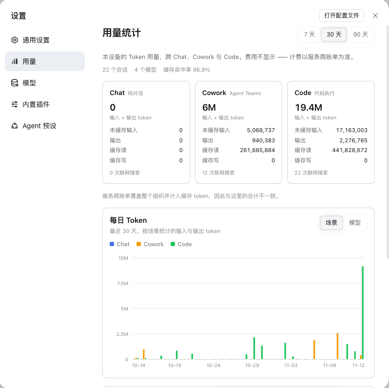
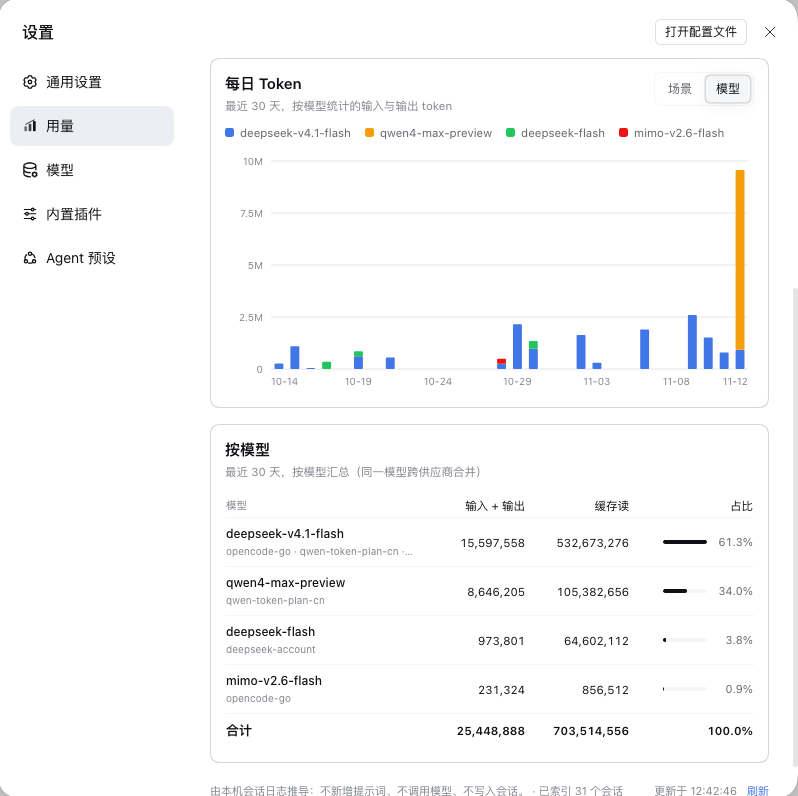
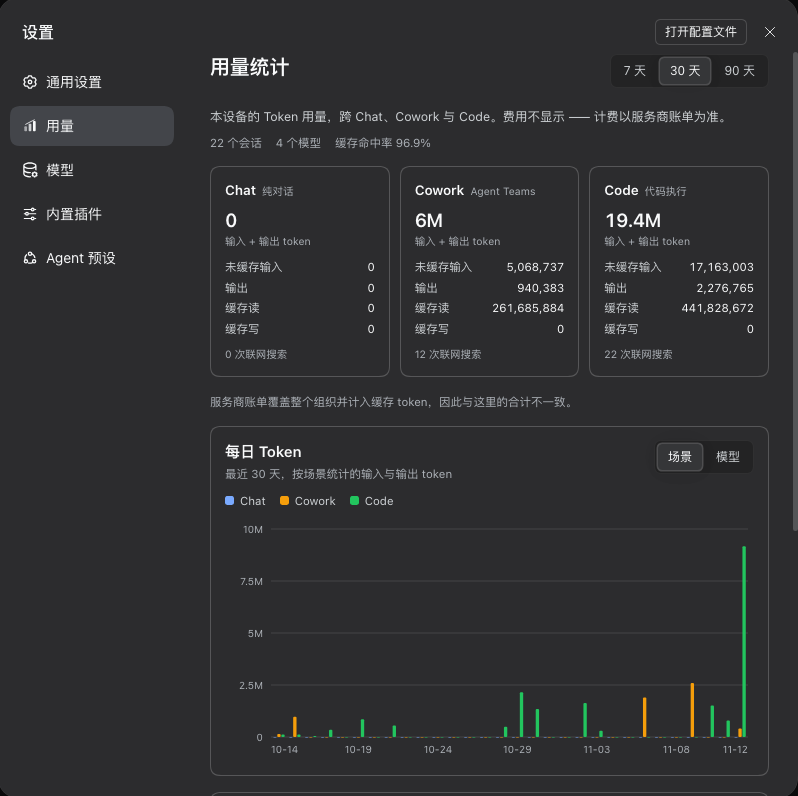

# dsh-usage-stats · 用量统计

> 本机 Token 用量，显示在 Harness 设置的「用量」页 · DeepSeek Harness 插件

**中文：** 看清本机的 token 花在了哪里：Chat / Cowork / Code 三张场景卡片、每日 Token 柱状图、按模型明细，全部推导自 Harness 已经写下的本地会话日志。

**English:** See where this device's tokens went: Chat, Cowork and Code cards, tokens per day, and a per-model breakdown, all folded from the local session logs the Harness already writes.

页面上的每一组数字都来自 Harness 本来就会记录的会话日志。插件不新增提示词、不注册工具、不调用模型，也不往会话里写任何东西，更不访问外部服务——页面只和 Harness 宿主上的一条本地路由打交道。同一批日志，折叠出来的数字永远一致。

[English →](README.md)

## 截图







## 页面内容

打开 Harness 的设置面板，在左侧导航里点「用量」（英文界面是 **Usage**）。整页自上而下：

1. **标题与范围**——7 / 30 / 90 天切换，默认 30 天；切换后立即重新取数。
2. **三张场景卡片**——Chat、Cowork、Code。每张卡片以「输入 + 输出」作大数字，下面四行明细：未缓存输入、输出、缓存读、缓存写；卡片底部是这些会话的联网搜索次数。
3. **账单口径说明**——服务商账单覆盖整个组织并计入缓存 token，所以和这里的合计对不上。
4. **每日 Token**——柱状图，可在「场景 / 模型」之间切换分组，悬停某天看明细。
5. **按模型**——每行一个模型，带占比条。
6. **页脚**——说明数字由什么推导、更新时间，以及「刷新」按钮。

几个细节：

- **大数字与明细。** 卡片大数字是「输入 + 输出」，不含缓存，和参考页一致；缓存读、缓存写单列，因为服务商对它们的计费方式不同。明细行显示带千分位的精确值，大数字与图表用 K/M/B 简写。
- **摘要小字。** 副标题下方三枚：范围内有活动的会话数、范围内的模型数、缓存命中率——缓存读 ÷（输入 + 缓存读 + 缓存写）。
- **图表。** 场景模式下每天三根并排柱（Chat / Cowork / Code），各用场景色；模型模式下每天一根堆叠柱，取总量前六的模型加「其他」。Y 轴五条刻度线，X 轴约六个日期标签；悬停某天显示各序列的值与当天合计；范围内没有数据时显示「这段时间还没有用量」。
- **表格。** 按「输入 + 输出」降序。同一个模型 id 即使由多个供应商服务也只占一行，供应商列在模型名下方；共四列：模型、「输入 + 输出」、缓存读、占比。「输入 + 输出」单元格的悬停提示里保留输入与输出的精确值；占比 = 该模型的「输入 + 输出」÷ 范围内全部模型，画成小条加百分比；表格末尾有一行合计。
- **刷新与加载。** 首次打开显示骨架卡片和「正在汇总本机会话…」，等第一次扫描完成；之后页面在可见时每 10 秒轮询一次，「刷新」立即重取。刷新失败会保留上次数字，并在页脚标注。
- **主题与语言。** 页面跟随 Harness 的深浅色主题与语言设置——界面文案、设置导航里的「用量 / Usage」和图表日期标签都随 DSH 语言变化——只用 Harness 自己的 `--dsw-*` 设计 token；在 `prefers-reduced-motion: reduce` 下关闭动画。

## 它是怎么工作的

```
$DSH_HOME/sessions/**/session.v4.jsonl.zstd
        │  只读扫描，逐帧解压 zstd
        ▼
$DSH_HOME/cache/usage-stats/index.json
        │  路径 · size/mtime · 场景 · 按天 token 桶
        ▼
设置 →「用量」 卡片 · 每日 Token · 按模型
```

### 只读会话日志

Host 侧递归扫描 `$DSH_HOME/sessions` 下的 `session.v4.jsonl.zstd` 与未压缩的 `.jsonl`（`$DSH_HOME` 取环境变量 `DSH_HOME`，没有则为 `~/.dsh`），从不往会话里写东西。

Harness 的 JSONL 后端把每个 flush 批次压成一个独立的 zstd 帧再拼接，而 Node 的 zstd 解码只会解出第一帧。所以插件自己扫描帧头，逐帧解压、拼回明文，并丢弃尾部不完整的帧。事件折叠只读需要的行：`assistant/message` 与 `assistant/attempt` 上的 usage 对象、`request/context` / `request/header` 上的模型路由、`tool/call` 上的工具名。

### 和 DSH 的记账口径一致

这里的数字遵循 Harness 自己的 `tokenUsage` 记账，而不是另立一套：

- `assistant/message` 取第一个合法的 `usage` 对象；消息本身没有时，退回最后一个流式 usage chunk；
- `assistant/attempt` 取最后一个 usage chunk；
- 同一个 turn 与 step 又来一条抽样时，新值替换旧值而不是叠加，同一次尝试的多个流式样本不会重复计数；`llm/retry-started` 会清空这个替换槽，让失败的尝试和重试各记一笔，与 DSH 的行为一致；
- 缺失的缓存桶按 0 计；模型取自 assistant 消息的 `source`，缺失时回退到最近一次请求路由、再退到未知模型；联网搜索归因给最近一次 assistant 消息所用的模型。

正因如此，逐会话总量与 Harness 维护的 `tokenUsage` 投影缓存（`$DSH_HOME/storages/session_projcache`）一致：两边逐会话对账吻合。

### Chat、Cowork、Code 分别是什么

这个页面的布局参考 Claude 桌面版的 Usage 页，它把用量分成 Chat、Cowork、Code 三个入口。DSH 没有这些入口，所以插件按会话用过的工具，把每个会话归到一个场景，Agent Teams 优先：

| 卡片 | 会话用过…… |
| --- | --- |
| Cowork · Agent Teams | 任一 Agent Teams 工具：`spawn_teammate`、`send_message`、`team_task_*`、`list_agents`、`wait_agent`、`interrupt_agent` |
| Code · 代码执行 | 任一代码执行工具：`bash`、`pwsh`、`run_code`、`terminal`、`shell`、`exec`、`write`、`edit`、`apply_patch`、`str_replace*`、`fs_write`、`fs_edit`、`notebook`、`jobs`、`job_*`、`workflow`、`ralph`、`plugin_manager`、`worktree` |
| Chat · 纯对话 | 上面两类都没有 |

场景属于整个会话，而不属于某一轮：只要会话里任何一处用过 Agent Teams，它就归为 Cowork。这是对参考页三入口的近似，不是说 DSH 会话就是那三样东西。如果你从不使用代码或团队工具，所有用量都会落在 Chat 里。

### 索引缓存与速度

首次生成报告时，插件会把日志走一遍，在 `$DSH_HOME/cache/usage-stats/index.json` 写下紧凑索引：每个会话的文件路径、大小和 mtime、场景、模型、工作目录，以及按天的 token 与联网搜索桶。数百个会话、数百 MB 日志的库，首次全量扫描大约需要 3–10 秒（取决于日志体积）；插件激活后还会在后台主动预热一次索引。

之后的报告对 size 和 mtime 都没变的文件直接复用，只重扫变化的部分，所以再次取数通常远低于 200 ms。索引用「临时文件 + rename」原子写入；索引损坏就整体重建；日志已消失的会话从索引里剔除；没有任何变化时不重写文件。

按天分桶使用宿主本地时区，日期记成 `YYYY-MM-DD`；当前 UTC 偏移一起存进索引，时区变了就整库重建，让过去的日子仍然按「本地的一天」来算。

页面向 Harness 宿主请求 `GET /dsh-usage-stats/report?days=7|30|90`，响应里带着卡片、图表背后的按天数据、模型列表和扫描统计，并标记 `cache-control: no-store`。

### 模型与供应商

同一个模型 id 可能由多个供应商提供服务（例如换了路由之后）。图表和表格都会把同一个 id 跨供应商合并，并在表格里列出供应商；模型占比是它的「输入 + 输出」除以范围内全部模型。图表显示总量前六的模型加上「其他」，表格列出范围内的全部模型。

## 安装

三种方式：

- **市场**：在插件市场里搜索 `dsh-usage-stats`（或「用量统计」）一键安装；
- **GitHub 源码**：`dsh plugin --profile <profile> add github:ruaibeite/dsh-usage-stats`；
- **本地目录**：`plugin_manager: install_bundle target=/path/to/dsh-usage-stats`。

插件行由包内自带的 `cordis.patch.yml` 注入，不需要手改 profile 的 patch 层。浏览器端随下一次页面加载生效；Host 侧在启动时注册，如果「用量」页出现了但报告取不到，重启一次 DSH 即可。卸载：`plugin_manager: remove_bundle`（或市场里卸载），然后重启桌面端让 Host 侧卸载。

## 隐私与账单

- **只在本地。** 插件读取本机的会话日志，索引放在 `$DSH_HOME/cache/usage-stats`；不访问外部网络、不写会话、不新增提示词、工具或模型调用。
- **只有一条本地路由。** 唯一的网络面是设置页向 DSH 宿主发起的同源 GET 路由，不上传、不共享任何数据。
- **不显示费用。** 页面统计的是 token，不是钱。不同供应商、套餐、折扣和缓存 token 的计价都不一样，写死一个价格只会是错的。
- **你的账单会和这里不同。** 服务商账单覆盖整个组织，按它自己的费率计缓存读写，还可能包含本机根本没见过的用量。对账看服务商账单，看趋势看这一页。

## 验证

```sh
cd dsh-usage-stats
npm test
```

两个纯 Node 测试套件，无依赖。`test/host.mjs` 覆盖 zstd 帧扫描（单帧、多帧、截断尾帧、坏 magic）、事件折叠（usage 变体、重试替换、模型回退、联网搜索归因）、场景映射、时区分桶、索引复用与失效、报告聚合，以及用假 ctx 驱动 `apply()`；本机有真实日志和投影缓存时还会逐会话对账。`test/render.mjs` 在仓内的小型 React harness 里加载 `client.js`，检查加载 / 错误 / 空范围 / 有数据四种页面状态、场景切换、两套图表分组、模型表与格式化函数，并校验内嵌词典与 `locale/*.json` 逐键一致。

## 已知限制

- **只有磁盘上有的。** 报告是请求时刻当前 `$DSH_HOME` 会话日志的快照；被删掉的日志、或位于另一个 DSH home 的日志不会计入。
- **首次扫描不是瞬间。** 耗时随日志库大小增长——几百 MB 的库通常需要 3–10 秒，期间页面显示骨架。
- **联网搜索是近似值。** 数字来自日志里的 `web_search`、`web_fetch`、`websearch`、`webfetch` 工具调用，不等于服务商计费的搜索次数；在 DSH 之外发生的搜索也看不到。
- **Chat / Cowork / Code 是映射。** 每个会话按用过的工具、Agent Teams 优先，只归入一个场景；它近似参考页的三个入口，而不是那三个产品的真实用量分类。
- **本地时区。** 按天分桶使用宿主本地时区；出行或夏令时变化会触发整库重建，可能让某一天的柱子换到另一个日期（token 不会丢）。
- **不显示费用。** 这是有意的；对账以服务商账单为准。

## License

MIT，见 [LICENSE](LICENSE)。